## Map Visual Question Answering Benchmarks

:::: columns
::: column
### Characteristics

- Visual Grounding
- Understanding Question
- Understanding Image
- Understanding Relationships
:::
::: column
### Many Tasks

- Object Detection
- Object Relation
- ...
:::
::::

## Map Visual Question Answering Test Items {subtitle="Test items consist of Map Image, Question and Reference Answer"}

:::: columns
::: column
### Map Image

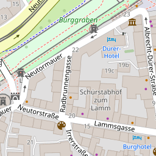
:::
::: column
### Question

What streets intersect with the street „Neutorstraße“?
:::
::: column
### Reference Answer

Neutormauer, Radbrunnengasse, Lammsgasse, Irrerstraße
:::
::::

## Requirements of Reference Answers {subtitle="Reference Answers must be consistent, scale, and content fidelity"}

:::: columns
::: column
### Map-content Fidelity

Answers use only features, properties and relations shown in this image.
:::
::: column
### Consistency

Same image and question create the same answer.
:::
::: column
### Scalability

Answers for many maps and complex maps without per-map annotation.
:::
::::

## Construction of Reference Answers {subtitle="Existing work visually inspects Map Images or derives Reference Answers from Source Data"}

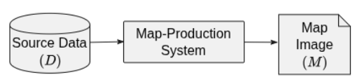

| Benchmark          | Map type  | Answer source | Construction     |
|--------------------|-----------|---------------|------------------|
| MapEval-Visual [1] | Reference | Map image     | Manual           |
| MapReader [2]      | Reference | Map image     | Machine-assisted |
| MapVerse [3]       | Mixed     | Map image     | Manual           |
| MAPWise [4]        | Thematic  | Map image     | Manual           |
| MapQA [5]          | Thematic  | Source data   | Programmatic     |
| MapIQ [6]          | Thematic  | Source data   | Programmatic     |

## Map image-based Construction Approach {subtitle="Every Map image needs to be manually inspected [1-4]"}

:::: columns
::: column
### Zoom 15

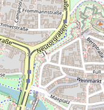
:::
::: column
### Zoom 16

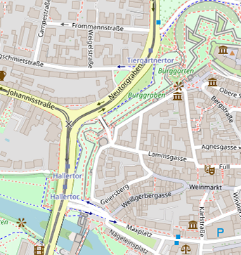
:::
::: column
### Zoom 17

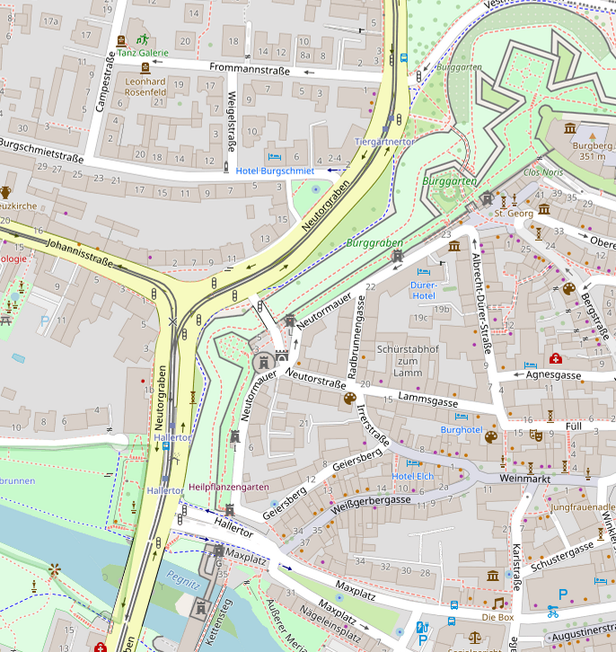
:::
::::

:::: columns
::: column
[✓ **Map-content fidelity**]{.ok}
:::
::: column
[× **Scalability**]{.warn}
:::
::: column
[× **Consistency**]{.warn}
:::
::::

## Source Data based Construction Approach {subtitle="Generalization rules change what the map shows [7, 9]"}

:::: columns
::: column
[**Selection**]{.accent} Source features are omitted.

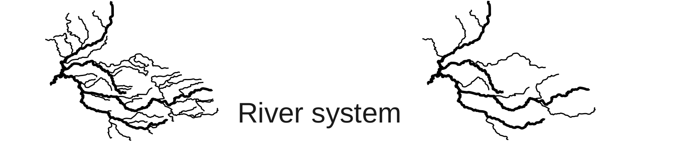

[**Simplification**]{.accent} Shapes differ from the source.

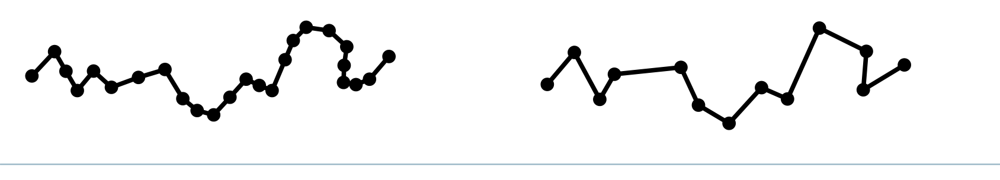
:::
::: column
[**Aggregation**]{.accent} Groups replace individual features.

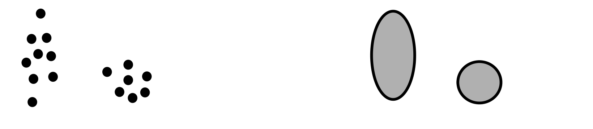

[**Displacement**]{.accent} Positions move for legibility.

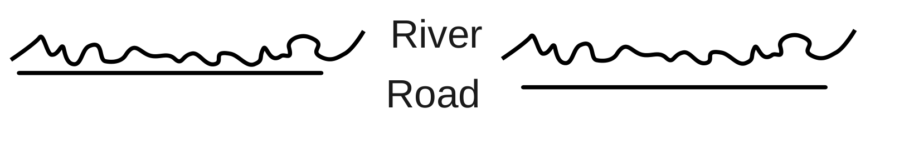
:::
::::

:::: columns
::: column
[× **Map-content fidelity**]{.warn}
:::
::: column
[✓ **Scalability**]{.ok}
:::
::: column
[✓ **Consistency**]{.ok}
:::
::::

## Relation between Source Data and Map Image {subtitle="A three-stage model of map production describes the resolved display elements as an explicit structured artifact"}

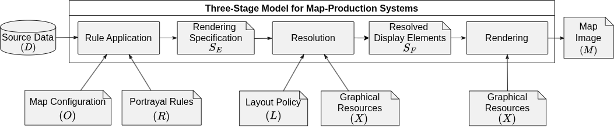

:::: columns
::: column
### Rule application

Feature-local decisions (e.g., selection, simplification).
:::
::: column
### Resolution

Group-based decisions (e.g., aggregation, placement, clipping).
:::
::: column
### Rendering

Drawing only.
:::
::::

## Solution: CartoGraph {subtitle="Record the content after the decisions are made"}

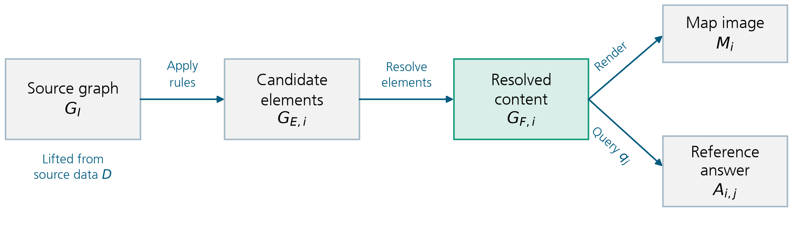

:::: columns
::: column
**Rules**

Selection, geometry, styles, candidate labels.
:::
::: column
**Resolution**

Placement, collisions, clipping, drawing order.
:::
::: column
**Recorded outcomes**

Geometries, visibility, resources, provenance.
:::
::::

## Example {subtitle="Neutorstraße, Nuremberg – OSM Standard Map Product, zoom 17, 256×256 px"}

:::: columns
::: column
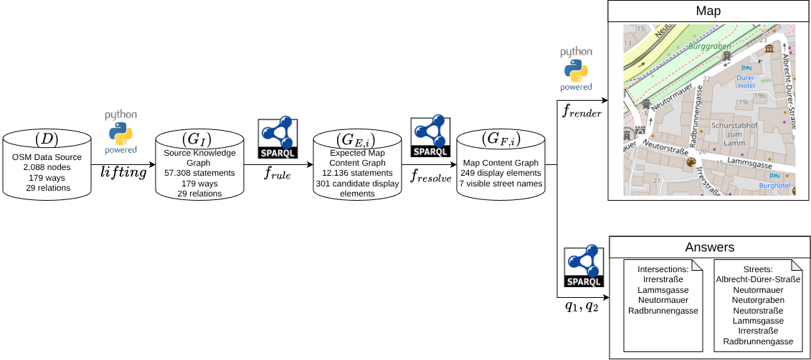
:::
::: column
[**57,308**]{.accent} statements in $G_I$

[**77**]{.accent} construct rules

[**301**]{.accent} candidate elements

[**249**]{.accent} final elements
:::
::::

## Example: Benchmark datasets for different Tasks {layout=image-left subtitle="Nürnberg Castle: query results linked to image annotations"}

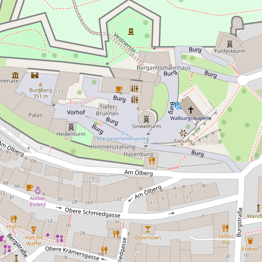

**Benchmark dataset (200 images)**

1. OCR (Bounding Box + Label)
2. Object Detection (Bounding Box + Class)
3. Instance Segmentation (Geometry + Class)

## Discussion

:::: columns
::: column
[✓ **Map-content fidelity**]{.ok}

Answers restricted to recorded final map content.
:::
::: column
[✓ **Scalability**]{.ok}

Rules and queries reused across 200 maps, no manual steps.
:::
::: column
[✓ **Consistency**]{.ok}

Explicit, query per question.
:::
::::

:::: columns
::: column
### Question specificity

- “Which streets *intersect* Neutorstraße?”
- `sfIntersects`: 4 streets, `sfCrosses`: 0
:::
::: column
### Implementation differences

- Map-product fidelity depends on how completely stylesheets, configuration and
  renderer behaviour are translated
- Omitted rules or manual edits: consistent, but unlike the intended product
:::
::::

## Conclusion

:::: columns
::: column
### Problem

- Reference Answers are hard to get
- Reading map images: not scalable, not consistent
- Querying source data: ignores generalization
:::
::: column
### Solution

- Record the final map content as a graph
- Render the image from it
- Query the answers from it
:::
::: column
### Future Work

- More map products
- Validate against reference renderers
- Generate questions from the graph
:::
::::

# Appendix

## Record the content after the decisions are made {subtitle="Render the image and query the answers from one resolved graph"}


:::: columns
::: column
**Rules**

Selection, geometry, styles, candidate labels.
:::
::: column
**Resolution**

Placement, collisions, clipping, drawing order.
:::
::: column
**Recorded outcomes**

Geometries, visibility, resources, provenance.
:::
::::

## Two ways to build reference answers {subtitle="Both miss one of three requirements"}

:::: columns
::: column
### Inspect the map image

Manual or machine-assisted reading.

Faithful, but every label must be found and tied to a geometry.

[**Does not scale.**]{.warn}

MapEval-Visual, MapReader, MapVerse, MAPWise
:::
::: column
### Extract from source data

Programmatic queries over the dataset.

Scales, but assumes source data equals image content.

[**Not faithful to the image.**]{.warn}

MapQA, MapIQ
:::
::::

:::: columns
::: column
[**Scalability**]{.accent}

No manual annotation per map.
:::
::: column
[**Consistency**]{.accent}

Same rules for every item.
:::
::: column
[**Map-content fidelity**]{.accent}

Only what *this* image shows.
:::
::::

## Answers from the final map content {subtitle="SELECT queries over the resolved content – each row keeps its source object"}

:::: columns
::: column
### $q_1$ Street names

Which street names are shown?

Albrecht-Dürer-Straße, Irrerstraße, Lammsgasse, Neutorgraben, Neutormauer,
Neutorstraße, Radbrunnengasse

[$|A_{i,1}| = 7$]{.accent}
:::
::: column
### $q_2$ Intersections

Which streets intersect Neutorstraße?

Irrerstraße, Lammsgasse, Neutormauer, Radbrunnengasse – on geometries clipped to
the map extent.

[$|A_{i,2}| = 4$]{.accent}
:::
::: column
### Rows keep objects

Castle demo, zoom 18: visible street labels

```sparql
SELECT ?object ?label WHERE {
 ?object cg:visibleLabel ?label ;
  cg:inLayer [cg:layerName
   "roads-text-name"] .
}
```

[**16 instances, 7 names**]{.accent}
:::
::::

[**Each answer points back to a drawn element – not just a name.**]{.accent}

## Offline demo: visible street labels {layout=image-left subtitle="A result row identifies the corresponding map annotation"}

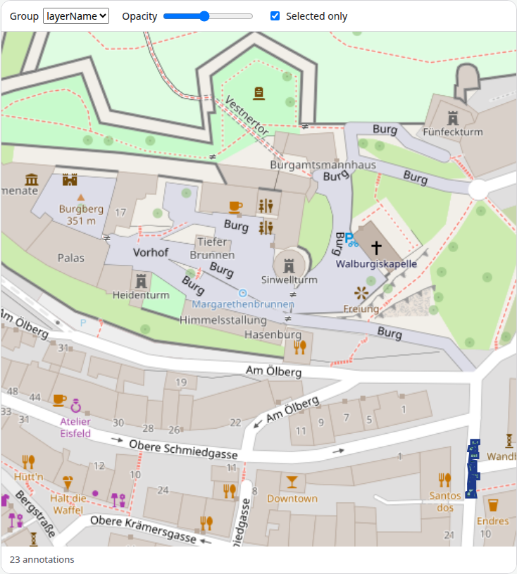

**Query**

Visible objects with a label in layer `roads-text-name`.

**Observed result**

16 label instances; 7 distinct names.

**Selection**

Burgstraße highlights its label pixels.

A label’s location is different from the street’s geometry.

## Offline demo: buildings and symbols {subtitle="Change the query while keeping the same map and graph"}

:::: columns
::: column
### Building layers

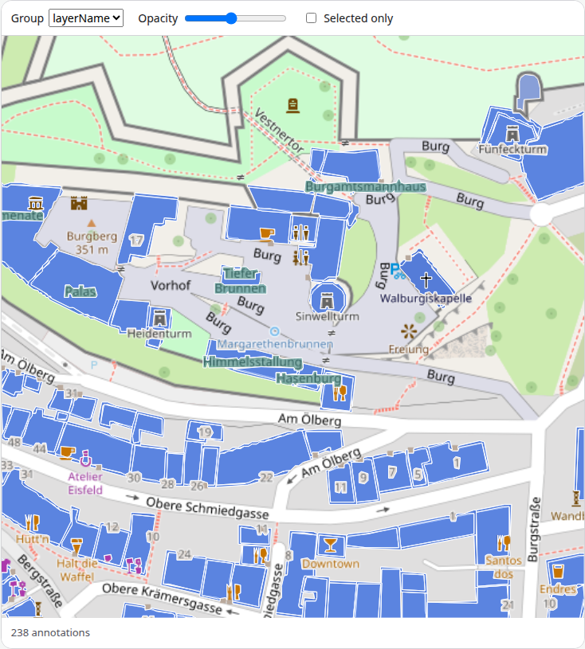
:::
::: column
### Markers and dots

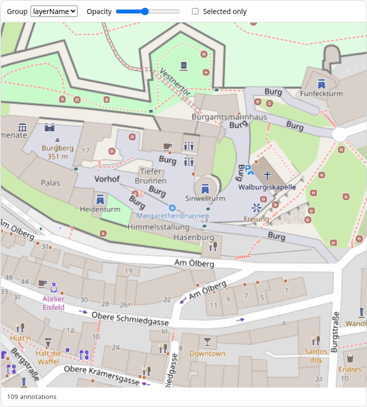
:::
::::

## Offline demo: Kaiserburg via Wikidata {layout=image-left subtitle="A semantic identity leads to a visible map object"}

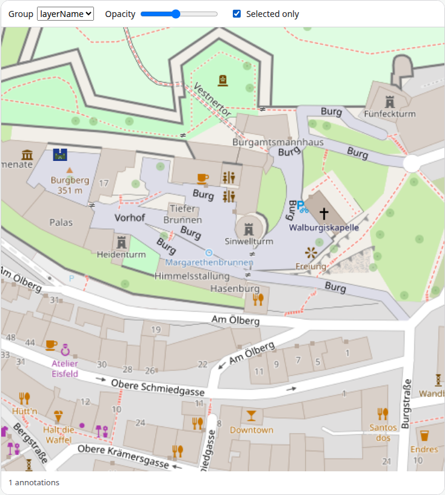

| `wd:Q707396`
| ↑ `owl:sameAs`
| **Source feature**
| ↑ `cg:representsFeature`
| **Visible object**
| ↓
| **Image annotation**

One result. The identity link is already in the loaded graph.

## Demo query: visible street-label instances {subtitle="Keep the object identifier so the table can highlight the image"}

```sparql
PREFIX cg: <https://w3id.org/cartograph#>
SELECT ?object ?label ?layerName WHERE {
  ?object a cg:VisibleObject ;
    cg:visibleLabel ?label ;
    cg:inLayer ?layer .
  ?layer cg:layerName ?layerName .
  FILTER(?layerName = "roads-text-name")
}
ORDER BY ?label ?object
```

Repeated names identify separate label instances. Select Burgstraße in the results table
to inspect its placement.

## References

:::: columns
::: column
**Paper**

Dorsch, Henselmann & Harth. *CartoGraph: Graph-Based Reference Answers for Map Visual
Question Answering Benchmarks*. SPARK 2026 manuscript.

**Reviewed benchmarks**

| \[1\] [Dihan et al. (2025), MapEval](https://openreview.net/forum?id=hS2Ed5XYRq)
| \[2\] [Zhang et al. (2025), MapReader](https://doi.org/10.1080/13658816.2025.2455112)
| \[3\] [Bhat et al. (2026), MapVerse](https://doi.org/10.1109/WACV61042.2026.00788)
| \[4\] [Mukhopadhyay et al. (2025), MAPWise](https://doi.org/10.18653/v1/2025.naacl-long.473)
| \[5\] [Chang et al. (2022), MapQA](https://openreview.net/pdf?id=znKbVjeR0yI)
| \[6\] [Srivastava et al. (2025), MapIQ](https://arxiv.org/abs/2507.11625)
:::
::: column
**Generalization**

| \[7\] [USGS CEGIS (2025), Generalization](https://www.usgs.gov/centers/cegis/science/generalization)
| \[8\] [ICA Commission on Multi-Scale Cartography, example results](https://generalisation.icaci.org/results.html)
| \[9\] [Noleander (2026), Map Generalization illustration](https://commons.wikimedia.org/wiki/File:Map_Generalization_simplification_cartography.svg), CC0; selected panels cropped and relabeled.

**Maps and demonstration**

Map data © [OpenStreetMap contributors](https://www.openstreetmap.org/copyright).
:::
::::
