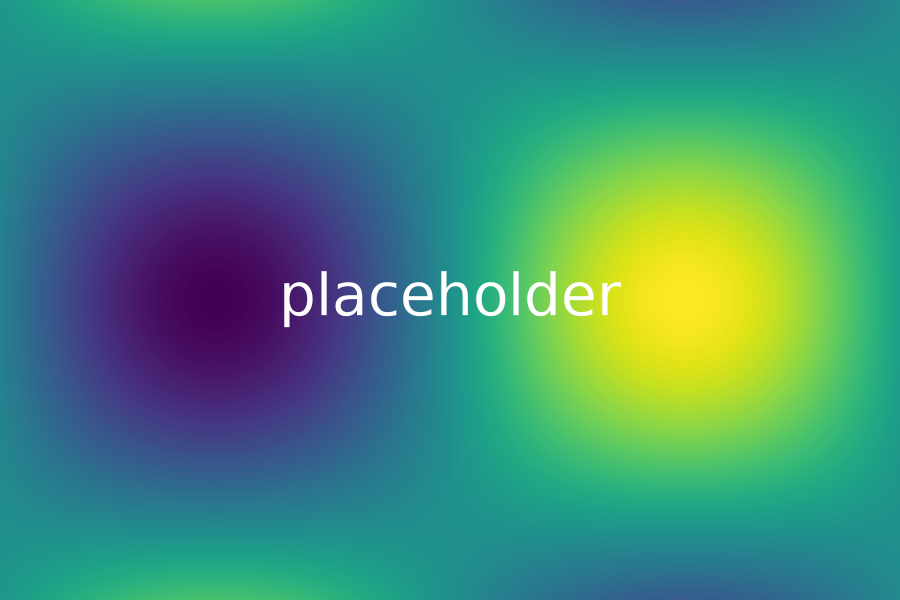

# Basics

## Text and lists {subtitle="Subline of the slide"}

Plain paragraph with **bold**, *italic*, `inline code` and a [link](https://quarto.org).

- First level
  - Second level
    - Third level
- Inline math $E = mc^2$

1. Numbered item
2. Another numbered item

::: notes
Speaker notes for the first slide.
:::

## Large text {layout=content-large}

- Fewer words
- Bigger type

## Math

Display formula:

$$\int_0^1 x^2 \, dx = \frac{1}{3}$$

Matrix and sum:

$$A = \begin{pmatrix} a & b \\ c & d \end{pmatrix}, \qquad \sum_{k=1}^{n} k = \frac{n(n+1)}{2}$$

## Code and table

```python
def greet(name: str) -> str:
    return f"Hello {name}"
```

| Layout  | Columns | Note            |
|---------|--------:|-----------------|
| content |       1 | default         |
| columns |     2–5 | equal widths    |

::: {.content-visible when-format="pptx"}
This line appears only in PPTX.
:::

::: {.content-visible when-format="beamer"}
This line appears only in beamer.
:::

# Layouts

## Two columns

:::: columns
::: column
Left column

- a
- b
:::
::: column
Right column

- c
- d
:::
::::

## Three columns {subtitle="With subline"}

:::: columns
::: column
**One**

Text of column one.
:::
::: column
**Two**

Text of column two.
:::
::: column
**Three**

Text of column three.
:::
::::

## Four columns

:::: columns
::: column
**One**

Text
:::
::: column
**Two**

Text
:::
::: column
**Three**

Text
:::
::: column
**Four**

Text
:::
::::

## Five columns

:::: columns
::: column
**One**

Text
:::
::: column
**Two**

Text
:::
::: column
**Three**

Text
:::
::: column
**Four**

Text
:::
::: column
**Five**

Text
:::
::::

## Image left {layout=image-left}



- Text beside the image
- Second point

## Image right {layout=image-right subtitle="Picture on the right"}


- Text beside the image
- Second point

## Full image {layout=full-image}


## Picture size {subtitle="Percent of the available area"}

:::: columns
::: column
`{width=50%}`

{width=50%}
:::
::: column
`{height=30%}`

{height=30%}
:::
::: column
default: fills the space


:::
::::

## Quote {layout=quote}

> Simplicity is the ultimate sophistication.

# Computation

## Computed figure

```{python}
#| echo: false
import numpy as np
import matplotlib.pyplot as plt

x = np.linspace(0, 2 * np.pi, 200)
fig, ax = plt.subplots(figsize=(6, 2.6))
ax.plot(x, np.sin(x))
ax.set_xlabel("x")
ax.set_ylabel("sin(x)")
plt.show()
```
