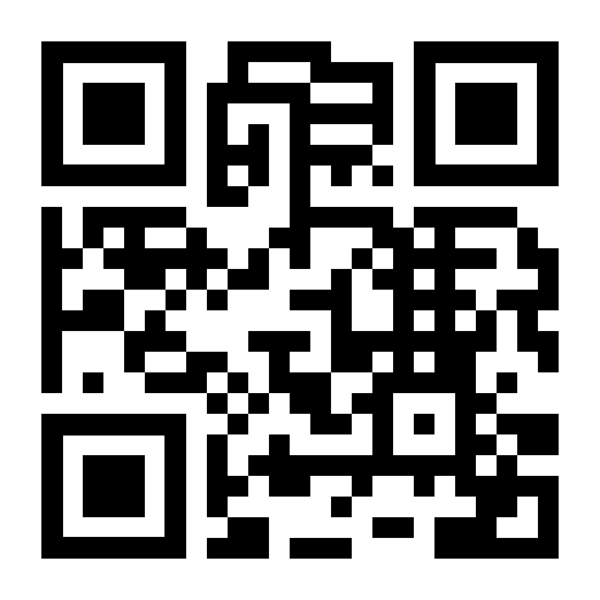
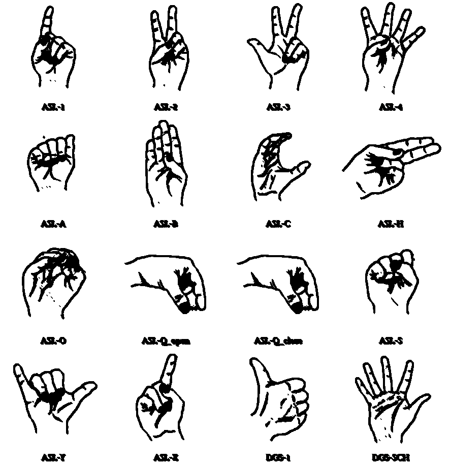
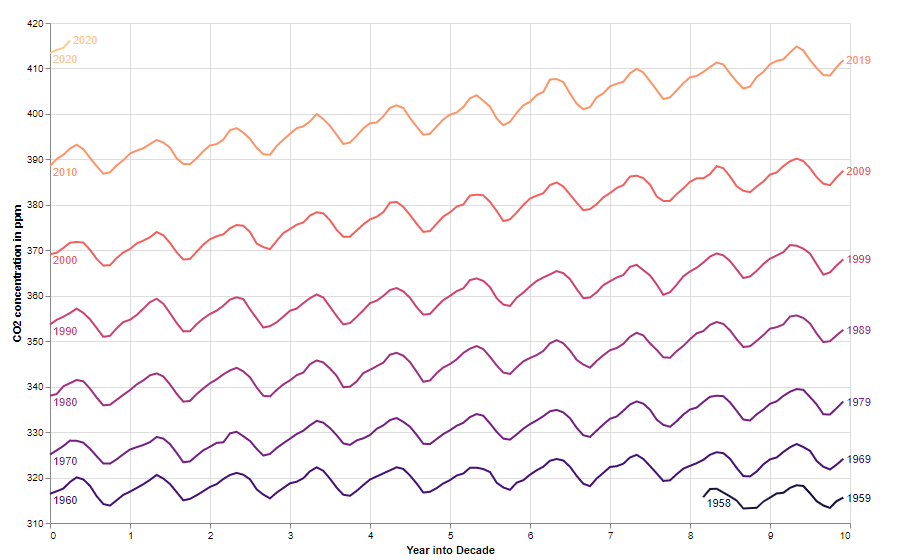
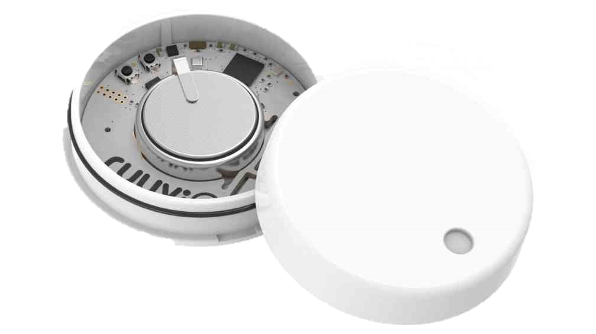
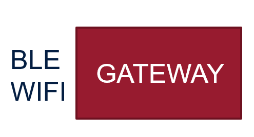
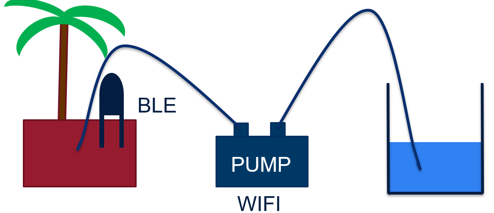

## Hot Topics in Web Technologies and the Internet of Things

- Practical Seminar for students to gain hands-on experience in software development
  with a focus on Web Technologies and the Internet of Things.
- The main result should be a **well documented** software project that is publicly
  available via GitHub.
  - **Benefit for students**: nice reference for the CV
  - **Benefit for Chair**: project can be used as reference or base for upcoming
    projects, even if they are of the distant future.

## General Information {layout=image-right}

- Chairholder: Prof. Dr. Andreas Harth
- Founded in May, 2018
- Located at Lange Gasse 20 (mainly 4th floor)
- Strong cooperation with the Fraunhofer IIS-SCS
  - Prof. Harth leads the Department of Data Spaces and IoT-Solutions
- Website: <https://www.ti.rw.fau.de/>

## Topics

:::: columns
::: column
**Data Visualization for Knowledge Graphs with PowerBI**

Developing a PowerBI SPARQL Connector
:::
::: column
**Data Visualization for Knowledge Graphs with Grafana**

Developing a Grafana SPARQL Datasource Plugin
:::
::: column
**Developing a Solid Application**
:::
::::

<!-- Hidden in the source deck (slide 5). Remove the comment markers to show it.

## Student Introduction

:::: columns
::: column
- What is your name?
- What are you studying and what is your seminar topic?
- What are your skills and interests that make you eligible for your seminar topic?
- Do you have any personal goals or future plans where this seminar can help you
  achieve?
  - E.g., „I want a student job as programmer and I want to use this seminar to have
    a reference for my job interview“
  - E.g., „I plan to write my thesis at this Chair“
:::
::: column
**Developing a Camera-based Application for Gestural Primitives Recognition (Hand)**

**Visualizing Semantically Annotated Sensor Data**

**Smart Gardening with the Web of Things**
:::
::::

-->

## Eligible Modules

- Bachelor WI - Seminar Wirtschaftsinformatik (5 ECTS; Studienbeginn vor 2020)
- Bachelor WI - Projektseminar (10 ECTS; Studienbeginn ab 2020)
- Master IIS - Seminar International Information Systems (5 ECTS; Studienbeginn vor 2021)
- Master IIS - Project Seminar (5 ECTS; Studienbeginn ab 2021)
- Master IIS - Project Seminar (10 ECTS; Studienbeginn ab 2021)
- Master Data Science – Application Subject IIS (5 ECTS)
- **Please check on mycampus, if the module is selectable for you!**

## Seminar Scope

- 1 ECTS = 30 Working Hours (5 ECTS: 150h / 10 ECTS: 300h)
- All work items must be submitted until **March 23rd, 2022**
- Examination method is seminar report / presentation, but the software project is
  most important.

## Work Items

- Software application
  - Software requirements are provided by supervisor
  - Source code must be uploaded to the GitHub repository of the Chair
  - The repository will be published after your final submission. Be aware of any
    licence issues
- An installation guide and tutorial must be created and uploaded to the GitHub
  repository as markdown or reStructuredText files (both in English).
- Code documentation must be created as HTML documents. There are tools for that. The
  documents can be hosted with GitHub Pages.
- A promotional video must be created that shows the application's capabilities
- A presentation must be given

## Code Documentation

- There are tools that search your source code for comments and code signatures and
  can generate HTML documents from it.
  - Doxygen, Javadoc, JSDoc, Sphinx, etc.
- You can discuss with your supervisor how the code documentation should be executed.
- You can see the following comments as a recommendation:
  - Describe each class, attribute/variable, function/method in one sentence
  - Describe input/output parameters and rising errors (if there are any)
  - Add your author information in each module

## Promo Video

- 1080p (1920x1080) Video in MPEG-4/H.264 (.mp4)
- Length: 120 – 180 seconds
- Content:
  - Explain the problem the application aims to solve
  - Explain and show how the application solves the problem
- The video will be published on the Chair's YouTube Channel. Be aware of any
  copyright. You can reference the video to the GitHub-Repo afterwards.
- There are free options like OBS, OpenShot and DaVinci Resolve Community Version.

## Presentation

- Sign up for the Student Seminar Mailinglist. Your attendance is mandatory
  - <https://lists.fau.de/cgi-bin/listinfo/wiso-ti-seminar>
- Length: 20min + 10min Q&A
- Recommended Content/Structure:
  - Task description
  - Promo Video (as introductory teaser or wherever it fits)
  - Live Demonstration of Application (e.g., installation and tutorial you have
    created)
  - Issues / conflicts / limitations / lessons learned
  - Conclusion / future work

<!-- Hidden in the source deck (slide 12). Remove the comment markers to show it.

## Seminar Report

- If your module has the seminar report as an examination method, you must submit a
  ca. 15-page report.
- Unfortunately, the examination office does not recognize a GitHub repository as
  equivalent to a seminar report.
- In this seminar, the seminar report can be scientifically, but it is not required,
  because the main focus of this seminar is to produce a well-documented application.
- Besides the presentation content, you can just use your installation guide and
  tutorial text to reach the 15-page requirement.

-->

## GitHub Repository {layout=image-right}

- GitHub is a version control system based on Git.
- Your supervisor will create a GitHub Repository for you. If you have not yet signed
  up for GitHub, please do so.
- Your supervisor can help you, if you encounter any problems with Git.
- You are free to work on your own GitHub Repository, but the final source code must
  be pushed to the Chair's Repo.

## Webhosting / Paul Server

- You can use the Chair's Server Paul to host any of your Websites. Open a connection
  with Paul using `ssh (idm)@paul.ti.rw.fau.de` and your idm password. Afterward,
  create a folder `public_html` with `mkdir public_html`. This folder is hosted as
  directory and can be accessed via URL `www.paul.ti.rw.fau.de/~(idm)/`.
- If you want to test Backend Logic, you can run your Web server on a port like
  `www.paul.ti.rw.fau.de:3000`.
  - The Web server runs temporarily until you stop the program or close the ssh
    connection.
  - You are assigned a specific port range that projects do not clash, please ask your
    supervisor which ports you are allowed to use.

## Q&A

:::: columns
::: column
**Developing a Camera-based Application for Gestural Primitives Recognition (Hand)**

{height=42%}

Source: [doi:10.1145/3473856.3473871](https://doi.org/10.1145/3473856.3473871)
:::
::: column
**Visualizing of Semantically Annotated Sensor Data**

{height=22%}

{height=20%}

Sources: [Vega-Lite](https://vega.github.io/vega-lite/examples/layer_line_co2_concentration.html),
[heise online](https://heise.cloudimg.io/width/1008/q30.png-lossy-30.webp-lossy-30.foil1/_www-heise-de_/imgs/18/2/2/5/6/1/1/9/Ruuvi_Beacon-87765341e5345888.jpeg)
:::
::: column
**Smart Gardening with the Web of Things**

{height=14%}

{height=24%}
:::
::::
